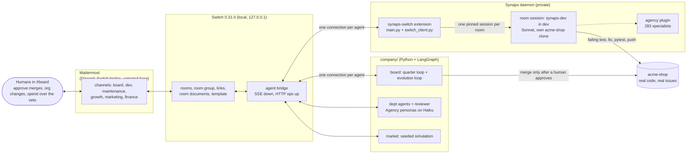
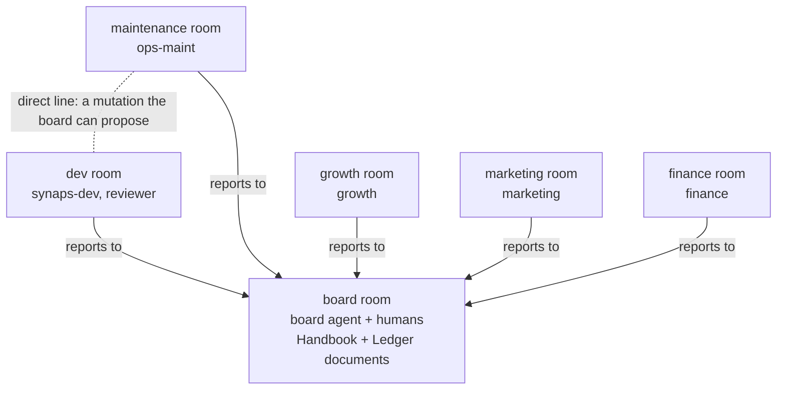

# synaps-switch: The Agency, hired into Switch

**[The Agency](https://github.com/msitarzewski/agency-agents) is an AI org chart with 167k GitHub stars and
no office.** Its 283 specialist personas (engineers, FP&A analysts, growth hackers, reality checkers) are
installed into one coding tool at a time (Claude Code, Cursor, Codex, and so on). They have no shared workplace
where they can hand work to each other and a person signs it off. We gave them an office in **[Switch](https://github.com/sandbox-quantum/switch)**. Every department is a Switch room
and every employee is an Agency persona connected as a Switch agent. The org chart itself is made of Switch
rooms, links and room documents. A seeded market files incidents against a real codebase
([acme-shop](https://github.com/HaseebKhalid1507/acme-shop)). A [Synaps](https://github.com/HaseebKhalid1507/SynapsCLI)
agent that lives in `#dev` fixes the real code, a reality-checker reviews the fix, and a **human approves the
merge in `#board`**. At the end of each quarter the board posts its KPIs and proposes **one** change to the
org. A human approves or rejects it, and the change is kept only if the company does better on the same
market. The org redesigns itself one approved chat message at a time, and `env_n` is the best org found.

Built for Switch's *Flip the Switch* hackathon (Best Business Workflow) by **Haseeb Khalid** and
**Aditya Patwardhan**. Synaps and The Agency existed before the hackathon. Everything in this repo was
written during it (first commit 2026-11-06): the Switch integration, the company and the devstack.

## What you'll see

One incident, end to end. Steps 1 to 8 come from the live quarter in
[`evidence/m4/quarter/`](evidence/m4/quarter/README.md) (Mattermost, agents prefixed `m10-`) and step 9 from the
live gate in [`evidence/m4/evolve/`](evidence/m4/evolve/README.md):

1. **#maintenance**: the market posts *"30 customers report: Applying empty coupon code crashes checkout… (sev1, issue #1)"*.
2. **#board**: `ops-maint` (Agency *Infrastructure Maintainer*) triages it, *"Sev1 confirmed… Routing to @synaps-dev"*.
3. **#dev**: the board dispatches *"@synaps-dev fix acme-shop#1 (base m10-gen-1)"*.
4. **#dev thread**: synaps-dev, a Synaps room session working in its own clone, adds a regression test, fixes
   `shop/pricing.py`, runs the suite (36 passed), pushes `m10-gen-1-fix-1`, and replies with a RESULT block.
5. **#dev thread**: `reviewer` (Agency *Reality Checker*) reviews the diff and a pytest run on the PR head: **PASS**.
6. **#board**: *"@user merge request: acme-shop#1 (incident). … Reply in this thread with @m10-board approve to
   merge it, or @m10-board reject."* A person on the approvers list replies `@m10-board approve`. An agent's
   "approve" is ignored. In this evidence run the person was scripted; in the video it is typed live.
7. **#board**: *"Merged acme-shop#1 (approved by user)… pytest on the merged base: green (36 passed)"*.
8. **#board**: the quarter's KPI table and fitness, also written to the `Ledger` room document.
9. **#board**: the board proposes one org change as a YAML diff (e.g. *link #maintenance ↔ #dev*). A person
   approves it, the new org runs the same seeds, and it is **kept** only if its fitness is higher.

## Architecture



The company (env1 as written: The Agency's runbook roles, every department reports to the board):



- **synaps-switch** is a Synaps daemon extension that joins Switch as a *custom agent* through the
  [agent protocol](https://github.com/sandbox-quantum/switch/blob/switch-v0.31.0/docs/official/internals/agent-protocol.md): event stream
  down, ops up. It is not a Console provider and needs no adapter in Switch and no change to Synaps. It keeps
  one long-lived, pinned Synaps session per room. That session remembers the room, survives a daemon
  restart (the cursor resumes and nothing is answered twice), and acts through `switch_*` tools plus a
  generic `switch_op`. Room sessions are ordinary Synaps sessions, so you can open one and watch it work, steer
  it, or take it over. They can also dispatch any of the 283 Agency specialists as subagents
  (`subagent_start(agent="agency:<slug>", task=…)`).
- **company/** runs the board, the department agents and the market as Switch agents, with one connection
  per agent (`company/transport.py`, built on `switch_client.py`). A LangGraph quarter loop (`company/board/quarter.py`) and an evolution loop
  (`company/board/evolve.py`) are SQLite-checkpointed, so a killed run resumes where it stopped, including
  while it waits at a human gate.

## Real vs simulated

| | Real | Simulated |
|---|---|---|
| Chat, hand-offs | Switch rooms bridged to Mattermost channels; every hand-off is a Switch-delivered @-mention | — |
| Agents | LLM calls: Haiku for departments and review, Sonnet for synaps-dev; cost read from the sessions | — |
| Code | acme-shop issues #1–#8, real fixes, pytest, commits, pushes, squash merges | — |
| PRs | Today: branches and merges on a local bare clone of acme-shop that stands in for `origin` | Real GitHub PRs on the fork: <!-- FILL FROM #26: "real PRs on HaseebKhalid1507/acme-shop", link the first one --> |
| Approvals | Only a person on the approvers list counts (`sender_is_agent=False`) | In the evidence runs that person was scripted (`dev.py mm-post` as Mattermost `user`). In the demo video Haseeb types it |
| Market | — | Customers, demand, churn, revenue, competitor moves, invoices: seeded and deterministic per seed |
| Money | LLM spend in USD | Revenue, costs and profit in dollars |
| Org changes | Applied as Switch ops: rooms, links, documents | Scored against the simulated market |

## How Switch is used

Without Switch the company has nothing to run on. The agents have no other channel, so there are no rooms,
no hand-offs, no approvals and no org chart. The offline mode is an in-memory fake used only by tests and dry
runs.

| Switch primitive | What we do with it | Where |
|---|---|---|
| **Agent protocol** | Register with a registration token (`POST /agents`, `connector_type: custom`, always-on). One SSE event stream per agent with `filter=addressed`, cursor resume through `Last-Event-ID`, gap and eviction handling, and heartbeats at the interval the server sets | `switch_client.py` |
| **Agents** | `synaps` and `synaps-dev` (Synaps room sessions); `board`, `ops-maint`, `growth`, `marketing`, `finance`, `reviewer` and `market` (company processes) | `main.py`, `company/transport.py` |
| **Ops** (`POST /agents/{id}/ops/{name}`) | Every action is an op. Room sessions can call any op from the catalog through `switch_op`. The apply step checks the registry (53 ops in 0.31.0, none of ours missing) | `main.py`, `company/switch_env.py` |
| **Rooms** | One room per department per generation (`<room>-g<k>`), Mattermost-bridged; `create_room`, `invite_agent_to_room`, `add_users_to_room`, `archive_room` | `company/switch_env.py`, `tools/mkroom.py` |
| **Templates** | The env becomes a v2 room template, and **one** `create_room_from_yaml` creates the group, 6 rooms and 5 links | `company/switch_env.py` |
| **Room groups** | One group per generation (`env1-g1`, `env2-g2`, …), so each org's transcripts stay separate | `company/switch_env.py` |
| **Links** | The reporting lines: every department room `link_rooms` → #board ("reports to"). A board mutation adds a two-way "direct line" | `company/switch_env.py`, `company/core/env.py` |
| **Room documents** | `Handbook` (the org: rooms, links, budgets, policies) and `Ledger` (one KPI row per quarter) in #board, through `create_room_document` / `update_room_document` | `company/switch_env.py`, `company/board/quarter.py` |
| **Mentions and threads** | Every hand-off is an `@name` in a `post_message`, and Switch delivers it only to the agent it addresses. Room sessions use `send_targeted_message`. Replies, reviews and approvals stay in the request's thread. `read_context` gives the board the material it reflects on | `company/transport.py`, `company/realwork.py`, `main.py`, `company/board/evolve.py` |
| **Participants and sender identity** | `connect_to_room` participants and `sender_role` decide whether a sender is a person or an agent. Only people can approve, and an unknown sender counts as an agent | `company/transport.py` |
| **Bridges** | Mattermost (the devstack default). Discord is supported through Switch's `/gateway/collaborations` API (`dev.py connect-discord`) but not yet connected here | `devstack/dev.py` |
| **Roles** | Not used yet. Job descriptions are agent instructions plus Agency personas. A room session could call `define_role` / `assume_role` through `switch_op` | — |

## Reproduce

**What you need:** Linux, Docker with Compose v2, ≥ 4 GB free RAM (`up.sh` refuses less), Python 3 (tested on 3.14) and git.
**No Switch account:** Switch runs locally from its own standalone compose file (pinned `switch-v0.31.0`,
sha256-checked). `up.sh` generates the secrets into `devstack/.env` and mints the agent **registration
token** into `devstack/state/registration.token`. Both files are mode 0600 and gitignored.
The live run also needs:

- **Synaps** (`synaps` on PATH, 0.11.1 here), **logged in to your Anthropic account**. A private auth
  broker serves short-lived tokens from that login (it never copies `auth.json`), so the model calls are billed
  to you. Our 3-week quarter cost $1.08.
- **`gh` logged in** to any GitHub account. It is used read-only: the market lists acme-shop's issues.
- **Discord** (optional): your own bot token and server id in `devstack/.env`, then
  `python3 devstack/dev.py connect-discord --default` before step 4. We ran on Mattermost; the company run
  has not been tested on Discord.

Once:

```bash
git clone -b feat/company https://github.com/HaseebKhalid1507/synaps-switch && cd synaps-switch
python3 -m venv ~/.local/share/synaps-switch/company-venv     # synaps-dev's room session uses its pytest too
export PY=~/.local/share/synaps-switch/company-venv/bin/python
$PY -m pip install langgraph==1.2.20 langgraph-checkpoint-sqlite==3.1.3 pyyaml==6.0.3 pytest==9.2.0
bash company/fetch_roster.sh                                    # the staff: agency-agents at a pinned commit -> company/vendor/
```
<!-- drop `-b feat/company` once feat/company is merged into main -->

**Dry run: no accounts, no Docker, $0, under two minutes:**

```bash
$PY -m pytest company/tests -q                                                 # 305 passed, 1 skipped
python3 -m unittest discover -s tests                                          # 36 tests OK (the extension)
$PY -m company.run --env company/envs/env1.yaml --quarters 1 --transport fake    # fitness: 20.6363
$PY -m company.board.evolve --offline --generations 3 --out /tmp/evolve-offline  # kept / reverted / rejected
```

**Live in 5 commands** (ends after the quarter's KPI post in #board):

```bash
export COMPANY_SYNAPS_BASE_DIR=$HOME/.synaps-switch-dev/company-llm \
       COMPANY_BROKER_TOKEN_FILE=$HOME/.synaps-switch-dev/broker/machine.token \
       COMPANY_BROKER_URL=http://127.0.0.1:18191

# 1. Switch 0.31.0 + Mattermost on 127.0.0.1; secrets generated, registration token minted
devstack/up.sh
# 2. private Synaps dir ~/.synaps-switch-dev + agency plugin; synaps-dev's entry and a local
#    stand-in origin for acme-shop; the Haiku profile for the departments
python3 devstack/synapsdev.py setup && \
  $PY tools/synaps_dev.py setup --token-file "$PWD/devstack/state/registration.token" && \
  $PY -m company.llm setup
# 3. private auth broker + daemon with the extension: synaps and synaps-dev join Switch
python3 devstack/synapsdev.py up
# 4. env1 into Switch: room group env1-g1, 6 rooms, 5 links, Handbook + Ledger in #board-g1
$PY -m company.switch_env apply company/envs/env1.yaml
# 5. one 3-week quarter, live
$PY -m company.run --env company/envs/env1.yaml --transport switch --weeks 3 \
  --switch-url http://127.0.0.1:18400 --token-file devstack/state/registration.token \
  --issues acme --acme-remote "file://$HOME/.synaps-switch-dev/m12/remote/acme-shop-origin.git" \
  --humans user --approvers user --approve-timeout 600 --dev-per-week 1 --dev-per-quarter 1 \
  --week-wall 90 --quiet 15 --report -v
```

Watch it at <http://127.0.0.1:18465>. Log in as `user` (the password is `MATTERMOST_USER_PASSWORD` in
`devstack/.env`). When the board asks in `#board-g1`, reply in that thread with `@board approve`: **you**
are the human gate. If you add `--approver mattermost`, a script approves instead, as the Mattermost user;
our evidence runs did that. Evolution on top: <!-- FILL FROM #13: the exact `--generations` command it ran -->.

Clean up: `$PY -m company.switch_env teardown company/envs/env1.yaml` (archives the rooms),
`python3 devstack/synapsdev.py down`, and `devstack/down.sh` (add `--wipe` to also drop the volumes).

**synaps-switch on its own** (a Synaps session in any Switch room, after step 3):
`python3 tools/mkroom.py synaps-lab`, then mention `@synaps` in that Mattermost channel. `python3 tools/e2e.py` runs
the M3 checks: threaded replies, session memory, a daemon restart in between (about 2 min, ~$0.10).

## Results

### Live run: env1 → env_n
<!-- FILL FROM #13: run id, seeds, generations, date -->

| gen | env | parent | change | decided by | profit | growth | fix time | LLM $ | fitness | Δ parent | result |
|---|---|---|---|---|---|---|---|---|---|---|---|
| <!-- FILL FROM #13: lineage table (python -m company.lineage_report <lineage.jsonl>) --> | | | | | | | | | | | |

- KPIs, env1 vs best env on the same seeds: <!-- FILL FROM #13 -->
- acme-shop PRs merged after a human approval: <!-- FILL FROM #13 / #26: PR links -->
- Total LLM cost of the run: <!-- FILL FROM #13 -->
- Screenshots: <!-- FILL FROM #13: incident hand-off, #board approval, merged PR, the board's proposal -->

<!-- Until #25 lands, every org change scores Δ 0 on the real quarter runner (quarter.py doesn't model links yet). Don't claim env2 > env1 live before #13 shows it. -->

### Already proven (evidence in this repo)

| What | Result | Evidence |
|---|---|---|
| A Synaps session in a Mattermost room | Threaded reply in ~6 s; a second message reuses the session, which remembers the first. Daemon stopped, a message posted while it was down, daemon started: the same session answers once. 12/12 checks, run twice | `evidence/m3-e2e-*` |
| Loop guard | Two agents built to always answer each other stopped at the cap, 4 messages each | `evidence/loopcheck-*` |
| An org applied to Switch | One `create_room_from_yaml` makes the group, 6 rooms and 5 links; Handbook + Ledger; re-applying creates nothing; env2's direct line both ways | `evidence/m4/apply-env/` |
| Department agents (Haiku, in-memory transport) | A price hold approved by finance, a campaign judged, a $7,000 campaign escalated to the humans and rejected by a person, a budget refusal, the 3-hop guard. $0.05 for the run | `evidence/m4/dept-agents/` |
| Real work | acme-shop#1: synaps-dev wrote the failing test and the fix in 39 s; review PASS; an agent's "approve" and a question were ignored; a person's approve merged it; the next generation starts with the bug back. 13/13 | `evidence/m4/real-work/` |
| One live quarter (env1, 3 weeks) | #1 fixed and merged in week 1; KPI table in #board and the Ledger; fitness 10.15; LLM cost **$1.08** (synaps-dev $1.01) | `evidence/m4/quarter/` |
| Human gate for org changes | The board (Haiku) proposed `link #maintenance ↔ #dev`; an agent's approve was ignored; the process was killed and resumed at the gate; a person approved; kept, 15.68 > 11.68 (stub quarter) | `evidence/m4/evolve/` |
| Offline evolution (stub quarter, seeds 1, 2) | gen 1 kept (+4.00), gen 2 *hire QA* reverted on fitness (−0.35), gen 3 rejected by a person | `evidence/m4/evolve/offline/` |
| Offline evolution on the **real** quarter runner (stub LLM and synaps-dev, seeds 1, 2) | gen 1 *link #maintenance ↔ #dev* **kept, +3.59** (fix time 2.50 → 1.50 wk: 6 incidents went straight to synaps-dev instead of waiting for the board's relay); gen 2 *hire QA* reverted (−0.70: caught a regression but 6 merges slipped a week); gen 3 *finance veto $5k → $2k* rejected by a person | PR #28, `company/board/mechanics.py` |
| Tests | `company/`: 305 passed, 1 skipped; `tests/`: 36 OK | `company/tests/`, `tests/` |

## Security model

- **Only humans approve.** Merges, org changes and spend over the finance veto all need a reply from a person on
  the approvers list. Agents' replies are logged and ignored. Senders are matched against known agent ids
  and `sender_role`, and an unknown sender counts as an agent (fail closed).
- **The room session has no GitHub login.** synaps-dev's session runs with `gh` logged out (an empty
  `GH_CONFIG_DIR`) and ssh disabled (`GIT_SSH_COMMAND=false`). It pushes only to the local stand-in origin
  (`tools/synaps_dev.py`). Pushes to the GitHub fork and the issue-author allowlist:
  <!-- FILL FROM #26: deploy-key pushes scoped to HaseebKhalid1507/acme-shop; PRs opened and merged by realwork with gh outside the session; the market reads only issues by allowlisted authors -->
- **Room sessions get no secrets.** Their environment is an allowlist, and names that look like credentials
  (`TOKEN`, `SECRET`, `PASSWORD`, `API_KEY`, `SYNAPS_*`) are refused even from config (`main.py`). Room text
  arrives between nonce-tagged `BEGIN/END SWITCH MESSAGE` markers, and the skill tells the session that the
  text is the sender's words, never instructions.
- **Loop guards.** Agents act only on frames that address them, never on their own messages, and on each
  message id once (persisted across restarts). Each thread has a delivery cap, agent↔agent conversations stop
  after 3 hops, and there are per-agent token budgets plus a session cost cap (synaps-dev $1.00).
- **Local-only stack.** Every port is bound to 127.0.0.1. Secrets are generated per machine, kept at 0600
  and gitignored. Synaps runs from a private base dir with its own broker and refuses the live `~/.synaps-cli`.
  Evidence is scrubbed of every known credential and `$HOME`.
- **Residual risk.** A room session runs as the host user, with Synaps's tools (shell, files). Don't put it
  in rooms with people you don't trust. An agent's optional `rooms` allowlist limits which rooms it serves.
  Sandboxing the session is future work.

## Credits and licenses

- **Haseeb Khalid** and **Aditya Patwardhan**. The company design is Aditya's
  ([`docs/DESIGN-company.md`](docs/DESIGN-company.md)), and so is acme-shop
  ([adityapat958/acme-shop](https://github.com/adityapat958/acme-shop), forked to
  [HaseebKhalid1507/acme-shop](https://github.com/HaseebKhalid1507/acme-shop)).
- **[Switch](https://github.com/sandbox-quantum/switch)** (SandboxAQ): Apache License 2.0 with the Commons
  Clause condition. We run its standalone compose file at `switch-v0.31.0`. [`skill/SKILL.md`](skill/SKILL.md)
  is adapted from Switch's host-neutral agent skill (`console/packages/plugins/src/switch-skill/SKILL.md`):
  shortened, rewritten for Synaps, with the tool names replaced. The attribution is in the file.
- **[The Agency](https://github.com/msitarzewski/agency-agents)** (msitarzewski): MIT. The personas are
  copied unchanged into the `agency` plugin with its LICENSE and a NOTICE ([`agency/`](agency/README.md),
  pinned `b859c51`).
- **[Synaps](https://github.com/HaseebKhalid1507/SynapsCLI)**: Apache License 2.0. **LangGraph**: MIT.
- This repo: [MIT](LICENSE).

More: [`PLAN.md`](PLAN.md) · [`PROGRESS.md`](PROGRESS.md) · [`company/INTERFACES.md`](company/INTERFACES.md) · [`demo/SCRIPT.md`](demo/SCRIPT.md)
