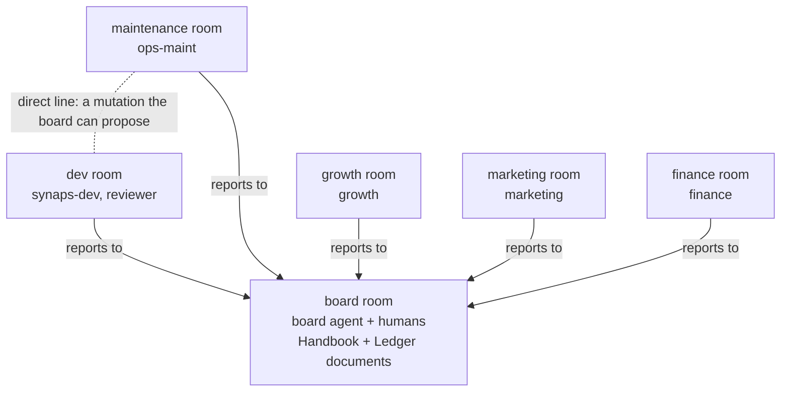

# synaps-switch: The Agency, hired into Switch

**[The Agency](https://github.com/msitarzewski/agency-agents) is an AI org chart with 167k GitHub stars and
no office.** Its 283 specialist personas (engineers, FP&A analysts, growth hackers, reality checkers) are
installed into one coding tool at a time (Claude Code, Cursor, Codex, and so on). They have no shared workplace
where they can hand work to each other and a person signs it off. We gave them an office in **[Switch](https://github.com/sandbox-quantum/switch)**. Every department is a Switch room
and every employee is an Agency persona connected as a Switch agent. The org chart itself is made of Switch
rooms, links and room documents. A seeded market files incidents against a real codebase
([acme-shop](https://github.com/HaseebKhalid1507/acme-shop)). A [Synaps](https://github.com/HaseebKhalid1507/SynapsCLI)
agent that lives in `#dev` fixes the real code, a reality-checker reviews the fix, and a **human approves the
merge in `#board`**. At the end of each quarter the board posts its KPIs and proposes **one** change to the
org. A human approves or rejects it, and the change is kept only if the company does clearly better on the same
market, by more than the noise in the LLM bill. The org redesigns itself one approved chat message at a time,
and `env_n` is the best org found.

Built for Switch's *Flip the Switch* hackathon (Best Business Workflow) by **Haseeb Khalid** and
**Aditya Patwardhan**. Synaps and The Agency existed before the hackathon. Everything in this repo was
written during it (first commit 2026-11-06): the Switch integration, the company and the devstack.

## What you'll see

One incident, end to end. Steps 1 to 8 come from the live quarter in
[`evidence/m4/quarter/`](evidence/m4/quarter/README.md) (Mattermost, agents prefixed `m10-`) and step 9 from the
live gate in [`evidence/m4/evolve/`](evidence/m4/evolve/README.md):

1. **#maintenance**: the market posts *"30 customers report: Applying empty coupon code crashes checkout… (sev1, issue #1)"*.
2. **#board**: `ops-maint` (Agency *Infrastructure Maintainer*) triages it, *"Sev1 confirmed… Routing to @synaps-dev"*.
3. **#dev**: the board dispatches *"@synaps-dev fix acme-shop#1 (base m10-gen-1)"*.
4. **#dev thread**: synaps-dev, a Synaps room session working in its own clone, adds a regression test, fixes
   `shop/pricing.py`, runs the suite (36 passed), pushes `m10-gen-1-fix-1`, and replies with a RESULT block.
5. **#dev thread**: `reviewer` (Agency *Reality Checker*) reviews the diff and a pytest run on the PR head: **PASS**.
6. **#board**: *"@user merge request: acme-shop#1 (incident). … Reply in this thread with @m10-board approve to
   merge it, or @m10-board reject."* A person on the approvers list replies `@m10-board approve`. An agent's
   "approve" is ignored. In this evidence run the person was scripted; in the video it is typed live.
7. **#board**: *"Merged acme-shop#1 (approved by user)… pytest on the merged base: green (36 passed)"*.
8. **#board**: the quarter's KPI table and fitness, also written to the `Ledger` room document.
9. **#board**: the board proposes one org change as a YAML diff (e.g. *link #maintenance ↔ #dev*). A person
   approves it, the new org runs the same seeds, and it is **kept** only if its fitness is higher.

## Architecture


The company (env1 as written: The Agency's runbook roles, every department reports to the board):



- **synaps-switch** is a Synaps daemon extension that joins Switch as a *custom agent* through the
  [agent protocol](https://github.com/sandbox-quantum/switch/blob/switch-v0.31.0/docs/official/internals/agent-protocol.md): event stream
  down, ops up. It is not a Console provider and needs no adapter in Switch and no change to Synaps. It keeps
  one long-lived, pinned Synaps session per room. That session remembers the room, survives a daemon
  restart (the cursor resumes and nothing is answered twice), and acts through `switch_*` tools plus a
  generic `switch_op`. Room sessions are ordinary Synaps sessions, so you can open one and watch it work, steer
  it, or take it over. They can also dispatch any of the 283 Agency specialists as subagents
  (`subagent_start(agent="agency:<slug>", task=…)`).
- **company/** runs the board, the department agents and the market as Switch agents, with one connection
  per agent (`company/transport.py`, built on `switch_client.py`). A LangGraph quarter loop (`company/board/quarter.py`) and an evolution loop
  (`company/board/evolve.py`) are SQLite-checkpointed, so a killed run resumes where it stopped, including
  while it waits at a human gate.

## Real vs simulated

| | Real | Simulated |
|---|---|---|
| Chat, hand-offs | Switch rooms bridged to Mattermost channels; every hand-off is a Switch-delivered @-mention | — |
| Agents | LLM calls: Haiku for departments and review, Sonnet for synaps-dev; cost read from the sessions | — |
| Code | acme-shop issues #1–#8, real fixes, pytest, commits, pushes, squash merges | — |
| PRs | Real GitHub PRs on the fork [HaseebKhalid1507/acme-shop](https://github.com/HaseebKhalid1507/acme-shop/pulls?q=is%3Apr): synaps-dev pushes the branch with a deploy key; the company process opens the PR, reviews it and squash-merges it into the generation's branch after a human approves. First: [#9](https://github.com/HaseebKhalid1507/acme-shop/pull/9) (#26) | The PRs merge into per-generation branches (`m13-gen-2`, …) cut from a `baseline` tag, never `main`, so every generation faces the same bugs. Tests and dry runs use a local bare clone instead |
| Approvals | Only a person on the approvers list counts (`sender_is_agent=False`) | In the evidence runs that person was scripted (`dev.py mm-post` as Mattermost `user`). In the demo video Haseeb types it |
| Market | — | Customers, demand, churn, revenue, competitor moves, invoices: seeded and deterministic per seed |
| Money | LLM spend in USD | Revenue, costs and profit in dollars |
| Org changes | Applied as Switch ops: rooms, links, documents | Scored against the simulated market |

## How Switch is used

Without Switch the company has nothing to run on. The agents have no other channel, so there are no rooms,
no hand-offs, no approvals and no org chart. The offline mode is an in-memory fake used only by tests and dry
runs.

| Switch primitive | What we do with it | Where |
|---|---|---|
| **Agent protocol** | Register with a registration token (`POST /agents`, `connector_type: custom`, always-on). One SSE event stream per agent with `filter=addressed`, cursor resume through `Last-Event-ID`, gap and eviction handling, and heartbeats at the interval the server sets | `switch_client.py` |
| **Agents** | `synaps` and `synaps-dev` (Synaps room sessions); `board`, `ops-maint`, `growth`, `marketing`, `finance`, `reviewer` and `market` (company processes) | `main.py`, `company/transport.py` |
| **Ops** (`POST /agents/{id}/ops/{name}`) | Every action is an op. Room sessions can call any op from the catalog through `switch_op`. The apply step checks the registry (53 ops in 0.31.0, none of ours missing) | `main.py`, `company/switch_env.py` |
| **Rooms** | One room per department per generation (`<room>-g<k>`), Mattermost-bridged; `create_room`, `invite_agent_to_room`, `add_users_to_room`, `archive_room` | `company/switch_env.py`, `tools/mkroom.py` |
| **Templates** | The env becomes a v2 room template, and **one** `create_room_from_yaml` creates the group, 6 rooms and 5 links | `company/switch_env.py` |
| **Room groups** | One group per generation (`env1-g1`, `env2-g2`, …), so each org's transcripts stay separate | `company/switch_env.py` |
| **Links** | The reporting lines: every department room `link_rooms` → #board ("reports to"). A board mutation adds a two-way "direct line" | `company/switch_env.py`, `company/core/env.py` |
| **Room documents** | `Handbook` (the org: rooms, links, budgets, policies) and `Ledger` (one KPI row per quarter) in #board, through `create_room_document` / `update_room_document` | `company/switch_env.py`, `company/board/quarter.py` |
| **Mentions and threads** | Every hand-off is an `@name` in a `post_message`, and Switch delivers it only to the agent it addresses. Room sessions use `send_targeted_message`. Replies, reviews and approvals stay in the request's thread. `read_context` gives the board the material it reflects on | `company/transport.py`, `company/realwork.py`, `main.py`, `company/board/evolve.py` |
| **Participants and sender identity** | `connect_to_room` participants and `sender_role` decide whether a sender is a person or an agent. Only people can approve, and an unknown sender counts as an agent | `company/transport.py` |
| **Bridges** | Mattermost (the devstack default). Discord is supported through Switch's `/gateway/collaborations` API (`dev.py connect-discord`) but not yet connected here | `devstack/dev.py` |
| **Roles** | Not used yet. Job descriptions are agent instructions plus Agency personas. A room session could call `define_role` / `assume_role` through `switch_op` | — |

## Reproduce

**What you need:** Linux, Docker with Compose v2, ≥ 4 GB free RAM (`up.sh` refuses less), Python 3 (tested on 3.14) and git.
**No Switch account:** Switch runs locally from its own standalone compose file (pinned `switch-v0.31.0`,
sha256-checked). `up.sh` generates the secrets into `devstack/.env` and mints the agent **registration
token** into `devstack/state/registration.token`. Both files are mode 0600 and gitignored.
The live run also needs:

- **Synaps** (`synaps` on PATH, 0.11.1 here), **logged in to your Anthropic account**. A private auth
  broker serves short-lived tokens from that login (it never copies `auth.json`), so the model calls are billed
  to you. In #13's recorded run a 3-week quarter with two fixes cost $0.90 to $1.98, and the whole recording
  (6 quarters on two seeds, 5 board proposals) $7.21.
- **`gh` logged in** to any GitHub account. In local mode it is used read-only: the market lists acme-shop's
  issues. In GitHub mode (#13) it also opens, reviews and merges the PRs on the fork, in the company process,
  never in synaps-dev's session; that needs an account with write access to the fork.
- **Discord** (optional): your own bot token and server id in `devstack/.env`, then
  `python3 devstack/dev.py connect-discord --default` before step 4. We ran on Mattermost; the company run
  has not been tested on Discord.

Once:

```bash
git clone -b feat/company https://github.com/HaseebKhalid1507/synaps-switch && cd synaps-switch
python3 -m venv ~/.local/share/synaps-switch/company-venv     # synaps-dev's room session uses its pytest too
export PY=~/.local/share/synaps-switch/company-venv/bin/python
$PY -m pip install langgraph==1.2.20 langgraph-checkpoint-sqlite==3.1.3 pyyaml==6.0.3 pytest==9.2.0
bash company/fetch_roster.sh                                    # the staff: agency-agents at a pinned commit -> company/vendor/
```
<!-- drop `-b feat/company` once feat/company is merged into main -->

**Dry run: no accounts, no Docker, $0, under two minutes:**

```bash
$PY -m pytest company/tests -q                                                 # 362 passed, 1 skipped
python3 -m unittest discover -s tests                                          # 39 tests OK (the extension)
$PY -m company.run --env company/envs/env1.yaml --quarters 1 --transport fake    # fitness: 20.6363
$PY -m company.board.evolve --offline --generations 3 --out /tmp/evolve-offline  # kept / reverted / rejected
```

**Live in 5 commands** (ends after the quarter's KPI post in #board). `tools/live_env.sh` gives the company
process its live settings at run time: the private broker and the Haiku profile (`COMPANY_BROKER_URL`,
`COMPANY_BROKER_TOKEN_FILE`, `COMPANY_SYNAPS_BASE_DIR` under `~/.synaps-switch-dev`) and, in GitHub mode, the
fork's `acme-github.env`. `--local` keeps acme-shop on the local stand-in origin; `tools/live_env.sh --check` lists
which settings are set, names only.

```bash
# 1. Switch 0.31.0 + Mattermost on 127.0.0.1; secrets generated, registration token minted
devstack/up.sh
# 2. private Synaps dir ~/.synaps-switch-dev + agency plugin; synaps-dev's entry and a local
#    stand-in origin for acme-shop; the Haiku profile for the departments
python3 devstack/synapsdev.py setup && \
  $PY tools/synaps_dev.py setup --token-file "$PWD/devstack/state/registration.token" && \
  tools/live_env.sh --local $PY -m company.llm setup
# 3. private auth broker + daemon with the extension: synaps and synaps-dev join Switch
python3 devstack/synapsdev.py up
# 4. env1 into Switch: room group env1-g1, 6 rooms, 5 links, Handbook + Ledger in #board-g1
$PY -m company.switch_env apply company/envs/env1.yaml
# 5. one 3-week quarter, live
tools/live_env.sh --local $PY -m company.run --env company/envs/env1.yaml --transport switch --weeks 3 \
  --switch-url http://127.0.0.1:18400 --token-file devstack/state/registration.token \
  --issues acme --acme-remote "file://$HOME/.synaps-switch-dev/m12/remote/acme-shop-origin.git" \
  --humans user --approvers user --approve-timeout 600 --dev-per-week 1 --dev-per-quarter 1 \
  --week-wall 90 --quiet 15 --report -v
```

Watch it at <http://127.0.0.1:18465>. Log in as `user` (the password is `MATTERMOST_USER_PASSWORD` in
`devstack/.env`). When the board asks in `#board-g1`, reply in that thread with `@board approve`: **you**
are the human gate. If you add `--approver mattermost`, a script approves instead, as the Mattermost user;
our evidence runs did that.

**Evolution, live, on real GitHub PRs** (what #13 ran; [evidence/m13](evidence/m13/README.md)). Once,
`$PY tools/synaps_dev.py setup --github --gen 1 --prefix m26-` (as #26 ran it) gives synaps-dev the fork's deploy
key and writes `~/.synaps-switch-dev/acme-github.env` ([how](evidence/m4/github/README.md#setup-exact-commands)).
Then, with you as the approver of every merge and org change (#13 added `--approver mattermost` for the merges and
[a scripted person](evidence/m13/gate_person.py) for the org changes):

```bash
tools/live_env.sh $PY -m company.run --env company/envs/env1.yaml --generations 3 --seeds 42 \
  --transport switch --weeks 3 --dev-per-week 1 --dev-per-quarter 2 \
  --agent-prefix m13- --room-prefix m13- --acme-prefix m13- \
  --switch-url http://127.0.0.1:18400 --token-file devstack/state/registration.token \
  --issues acme --acme-remote git@github.com:HaseebKhalid1507/acme-shop.git \
  --humans user --approvers user --approve-timeout 600 \
  --gate-room m13-board-g1 --gate-timeout 1800 --budget-usd 9 \
  --week-wall 90 --quiet 15 --db company/state/m13.db --evolve-db company/state/m13-evolve.sqlite \
  --out company/state/m13-out -v
```

The baseline quarter runs on env1, then each generation the board proposes one change in `#m13-board-g1` and
waits up to 30 min for a person; an approved change runs a whole trial quarter on its own rooms (`-g2`, `-g3`) and
branch (`m13-gen-2`, …). Use a fresh prefix per run: fix branches can't be reused.

Clean up: `$PY -m company.switch_env teardown company/envs/env1.yaml` (archives the rooms),
`python3 devstack/synapsdev.py down`, and `devstack/down.sh` (add `--wipe` to also drop the volumes).

**synaps-switch on its own** (a Synaps session in any Switch room, after step 3):
`python3 tools/mkroom.py synaps-lab`, then mention `@synaps` in that Mattermost channel. `python3 tools/e2e.py` runs
the M3 checks: threaded replies, session memory, a daemon restart in between (about 2 min, ~$0.10).

## Results

### Live run: env1 → env_n

2026-11-06, devstack (Switch 0.31.0 + Mattermost), env1 as the baseline, 3-week quarters, synaps-dev capacity
1/week and 2/quarter, **real PRs on [HaseebKhalid1507/acme-shop](https://github.com/HaseebKhalid1507/acme-shop/pulls?q=is%3Apr+m13-)**.
Run 1: seed 42, 3 generations. Run 2: seed 1, stopped by its $6 budget guard after 2. Proposals by the board
(Haiku); every decision by the Mattermost user `user`. **Approvals in this recorded run were scripted; in the demo
video they're typed live.** The policy was committed before the run: approve every merge whose review is PASS
with a green harness pytest, approve org changes in generations 1 and 2, reject generation 3
([evidence/m13/POLICY.md](evidence/m13/POLICY.md)).

Run 1, seed 42 (`$PY -m company.lineage_report evidence/m13/run1-seed42/lineage.jsonl`):

| gen | env | parent | change | decided by | profit | growth | fix time | LLM $ | fitness | Δ parent | result |
|---|---|---|---|---|---|---|---|---|---|---|---|
| 0 | env1 | — | seed | — | $20.8k | -11.2% | 2.50 wk | $1.09 | 13.62 | — | seed |
| 1 | env2 | env1 | link #maintenance ↔ #dev | user | $23.0k | -8.8% | 1.50 wk | $0.96 | 15.96 | +2.33 | ✅ kept |
| 2 | env3 | env2 | hire incident-commander (engineering/engineering-incident-response-commander) into #dev | user | $23.0k | -8.8% | 1.50 wk | $0.90 | 16.02 | +0.06 | ✅ kept |
| 3 | env4 | env3 | policy dev_capacity: — → 3 | user | — | — | — | — | — | — | ❌ rejected (human) |

**Under the rules as of #31, gen 2's +0.06 would be "↔ no effect" (Δ +0.06 < min-gain 0.5) and env2 would stay
the parent.** In fact it wouldn't reach #board at all. What changed in
[PR #33](https://github.com/HaseebKhalid1507/synaps-switch/pull/33):
- The board may only propose a lever the quarter reads (`company/board/levers.py`: the #maintenance ↔ #dev direct
  line, dev capacity, testing/* reviewers in #dev, the finance veto, budgets, price). Anything else, like an
  incident commander or a policy key nothing reads, is refused before the human gate: re-asked once, then the
  generation is skipped.
- A change is kept only if it beats its parent by more than `--min-gain` (0.5). Otherwise it's "↔ no effect" and
  the parent stays.
- A `set_dev_capacity` mutation now takes effect in its trial: `--dev-per-*` only set env1's baseline.

Run 2's gen 2 (`policy dev_capacity_per_quarter`) is refused by the first rule. Its +0.93, from a cheaper synaps-dev
session, is above min-gain, so the lever registry is what catches it.

Run 2, seed 1: env1 12.85 → env2 (`link #maintenance ↔ #dev`) 14.19, kept (+1.35) → env3 (`policy
dev_capacity_per_quarter → 4`) 15.12, kept (+0.93) ([table](evidence/m13/README.md#lineage)).

- **KPIs, env1 vs best env on the same seed:** fix time **2.50 → 1.50 weeks**, profit **$20,765 → $22,958**,
  revenue $25,766 → $27,958, growth −11.15% → −8.82%, customers 1,370 → 1,406, LLM $1.09 → $0.90, fitness
  **13.62 → 16.02** (seed 42). Seed 1: profit $20,080 → $22,214, fix time 2.50 → 1.50, fitness 12.85 → 15.12.
  The gain is the direct line: ops-maint handed sev1/sev2 incidents to synaps-dev in `#dev` the week they came in,
  instead of waiting a week for the board's relay ([the two chats side by side](evidence/m13/run1-seed42/threads.md)).
- **Human reject: yes** (run 1, gen 3). **Fitness revert: none, honestly.** The quarter is deterministic per seed
  except the real LLM bill, and both generation-2 changes did nothing mechanically (an incident commander is not a
  tester; `dev_capacity` isn't a policy key the mechanics read), so they were kept because their trial quarter's
  synaps-dev bill was lower ([why](evidence/m13/README.md#why-there-is-no-fitness-revert)). The revert path is
  shown offline on the same quarter runner (*hire QA*, −0.70, PR #28) and in the tests.
- **acme-shop PRs merged after a human approval: 12**, all written by synaps-dev, reviewed PASS, squash-merged into
  the generation's branch: env1 via the board relay
  [#10](https://github.com/HaseebKhalid1507/acme-shop/pull/10), [#11](https://github.com/HaseebKhalid1507/acme-shop/pull/11),
  [#16](https://github.com/HaseebKhalid1507/acme-shop/pull/16), [#17](https://github.com/HaseebKhalid1507/acme-shop/pull/17);
  evolved envs via the direct line [#12](https://github.com/HaseebKhalid1507/acme-shop/pull/12),
  [#13](https://github.com/HaseebKhalid1507/acme-shop/pull/13), [#14](https://github.com/HaseebKhalid1507/acme-shop/pull/14),
  [#15](https://github.com/HaseebKhalid1507/acme-shop/pull/15), [#18](https://github.com/HaseebKhalid1507/acme-shop/pull/18),
  [#19](https://github.com/HaseebKhalid1507/acme-shop/pull/19), [#20](https://github.com/HaseebKhalid1507/acme-shop/pull/20),
  [#21](https://github.com/HaseebKhalid1507/acme-shop/pull/21). The first real PR was
  [#9](https://github.com/HaseebKhalid1507/acme-shop/pull/9) (#26). `main` and `baseline` untouched.
- **Total LLM cost: $7.21** for both runs (run 1 $2.97, run 2 $4.23): synaps-dev (Sonnet) $6.69, reviews $0.15,
  departments + judge $0.31, board proposals $0.06. **Wall time 47 min 41 s** (21:54 + 25:47).
- **Chat exports** instead of screenshots (`devstack/dev.py mm-thread`, scrubbed): the incident hand-off, synaps-dev's
  fix, the review, the human approve and the merge, once through the board relay and once over the direct line,
  the KPI post, and the board's proposal → approve/reject threads: [threads.md](evidence/m13/run1-seed42/threads.md),
  raw JSON in `evidence/m13/run*/mattermost/`.

### Already proven (evidence in this repo)

| What | Result | Evidence |
|---|---|---|
| A Synaps session in a Mattermost room | Threaded reply in ~6 s; a second message reuses the session, which remembers the first. Daemon stopped, a message posted while it was down, daemon started: the same session answers once. 12/12 checks, run twice | `evidence/m3-e2e-*` |
| Loop guard | Two agents built to always answer each other stopped at the cap, 4 messages each | `evidence/loopcheck-*` |
| An org applied to Switch | One `create_room_from_yaml` makes the group, 6 rooms and 5 links; Handbook + Ledger; re-applying creates nothing; env2's direct line both ways | `evidence/m4/apply-env/` |
| Department agents (Haiku, in-memory transport) | A price hold approved by finance, a campaign judged, a $7,000 campaign escalated to the humans and rejected by a person, a budget refusal, the 3-hop guard. $0.05 for the run | `evidence/m4/dept-agents/` |
| Real work | acme-shop#1: synaps-dev wrote the failing test and the fix in 39 s; review PASS; an agent's "approve" and a question were ignored; a person's approve merged it; the next generation starts with the bug back. 13/13 | `evidence/m4/real-work/` |
| One live quarter (env1, 3 weeks) | #1 fixed and merged in week 1; KPI table in #board and the Ledger; fitness 10.15; LLM cost **$1.08** (synaps-dev $1.01) | `evidence/m4/quarter/` |
| Human gate for org changes | The board (Haiku) proposed `link #maintenance ↔ #dev`; an agent's approve was ignored; the process was killed and resumed at the gate; a person approved; kept, 15.68 > 11.68 (stub quarter) | `evidence/m4/evolve/` |
| Offline evolution (stub quarter, seeds 1, 2) | gen 1 kept (+4.00), gen 2 *hire QA* reverted on fitness (−0.35), gen 3 rejected by a person | `evidence/m4/evolve/offline/` |
| **Live evolution, real PRs (#13)** | Two runs (seeds 42, 1), 6 quarters, 12 PRs merged on the fork after a person approved; `link #maintenance ↔ #dev` kept both times (fix time 2.50 → 1.50 wk, +2.33 / +1.35); a human reject; no revert; $7.21, 48 min | `evidence/m13/` |
| Offline evolution on the **real** quarter runner (stub LLM and synaps-dev, seeds 1, 2) | gen 1 *link #maintenance ↔ #dev* **kept, +3.59** (fix time 2.50 → 1.50 wk: 6 incidents went straight to synaps-dev instead of waiting for the board's relay); gen 2 *hire QA* reverted (−0.70: caught a regression but 6 merges slipped a week); gen 3 *finance veto $5k → $2k* rejected by a person | PR #28, `company/board/mechanics.py` |
| Tests | `company/`: 362 passed, 1 skipped; `tests/`: 39 OK | `company/tests/`, `tests/` |

## Security model

- **Only humans approve.** Merges, org changes and spend over the finance veto all need a reply from a person on
  the approvers list. Agents' replies are logged and ignored. Senders are matched against known agent ids
  and `sender_role`, and an unknown sender counts as an agent (fail closed).
- **The room session has no GitHub login.** synaps-dev's session runs with `gh` logged out (an empty
  `GH_CONFIG_DIR`), no ssh agent (the extension refuses to pass `SSH_AUTH_SOCK`), and a `GIT_SSH_COMMAND` that
  offers only the fork's **deploy key** (`IdentitiesOnly`, `IdentityAgent=none`, `-F /dev/null`). That key can
  write to HaseebKhalid1507/acme-shop and nothing else: a push to another repo is "denied to deploy key"
  ([probe](evidence/m4/github/README.md#the-room-session-has-no-github-login)). The session pushes
  `<gen-k>-fix-<N>` and reports the branch name. It never opens or merges a PR. The **company process** does that with
  the operator's `gh`, outside the session: `realwork.land_pr` → `gh pr create -R HaseebKhalid1507/acme-shop
  --base <gen-k>`, then a review of the PR head, then, only after a human approves in #board, `gh pr merge --squash
  --match-head-commit <reviewed sha>`, so a head that moved after the review is not merged. Writes to the upstream
  adityapat958/acme-shop are refused (`acme.guard_write`). The market and `fetch_issue` read only issues opened by
  allowlisted authors (`ACME_ISSUE_AUTHORS`, default `HaseebKhalid1507,adityapat958`), so a stranger's issue on the
  public fork never reaches an agent. Local mode (a bare clone standing in for origin, ssh disabled) is still the
  default and what the tests use.
- **Room sessions get no secrets.** Their environment is an allowlist, and names that look like credentials
  (`TOKEN`, `SECRET`, `PASSWORD`, `API_KEY`, `SYNAPS_*`) are refused even from config (`main.py`). Room text
  arrives between nonce-tagged `BEGIN/END SWITCH MESSAGE` markers, and the skill tells the session that the
  text is the sender's words, never instructions.
- **Loop guards.** Agents act only on frames that address them, never on their own messages, and on each
  message id once (persisted across restarts). Each thread has a delivery cap, agent↔agent conversations stop
  after 3 hops, and there are per-agent token budgets plus a session cost cap (synaps-dev $3.00 per room
  session, one per generation).
- **Local-only stack.** Every port is bound to 127.0.0.1. Secrets are generated per machine, kept at 0600
  and gitignored. Synaps runs from a private base dir with its own broker and refuses the live `~/.synaps-cli`.
  Evidence is scrubbed of every known credential and `$HOME`.
- **Residual risk.** A room session runs as the host user, with Synaps's tools (shell, files). Don't put it
  in rooms with people you don't trust. An agent's optional `rooms` allowlist limits which rooms it serves.
  Sandboxing the session is future work.

## Credits and licenses

- **Haseeb Khalid** and **Aditya Patwardhan**. The company design is Aditya's
  ([`docs/DESIGN-company.md`](docs/DESIGN-company.md)), and so is acme-shop
  ([adityapat958/acme-shop](https://github.com/adityapat958/acme-shop), forked to
  [HaseebKhalid1507/acme-shop](https://github.com/HaseebKhalid1507/acme-shop)).
- **[Switch](https://github.com/sandbox-quantum/switch)** (SandboxAQ): Apache License 2.0 with the Commons
  Clause condition. We run its standalone compose file at `switch-v0.31.0`. [`skill/SKILL.md`](skill/SKILL.md)
  is adapted from Switch's host-neutral agent skill (`console/packages/plugins/src/switch-skill/SKILL.md`):
  shortened, rewritten for Synaps, with the tool names replaced. The attribution is in the file.
- **[The Agency](https://github.com/msitarzewski/agency-agents)** (msitarzewski): MIT. The personas are
  copied unchanged into the `agency` plugin with its LICENSE and a NOTICE ([`agency/`](agency/README.md),
  pinned `b859c51`).
- **[Synaps](https://github.com/HaseebKhalid1507/SynapsCLI)**: Apache License 2.0. **LangGraph**: MIT.
- This repo: [MIT](LICENSE).

More: [`PLAN.md`](PLAN.md) · [`PROGRESS.md`](PROGRESS.md) · [`company/INTERFACES.md`](company/INTERFACES.md) · [`demo/SCRIPT.md`](demo/SCRIPT.md)
